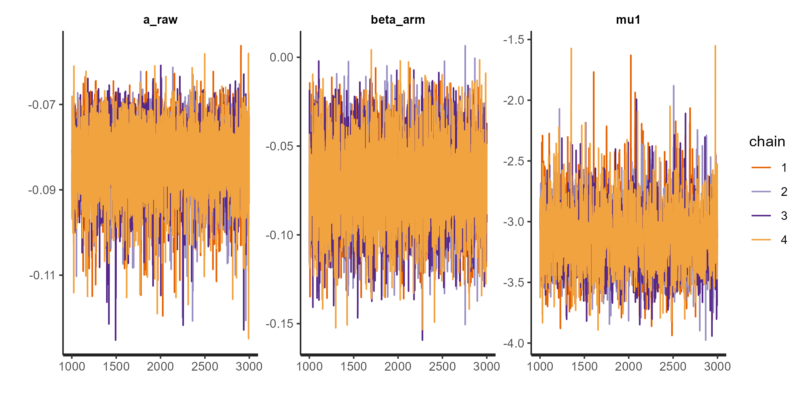
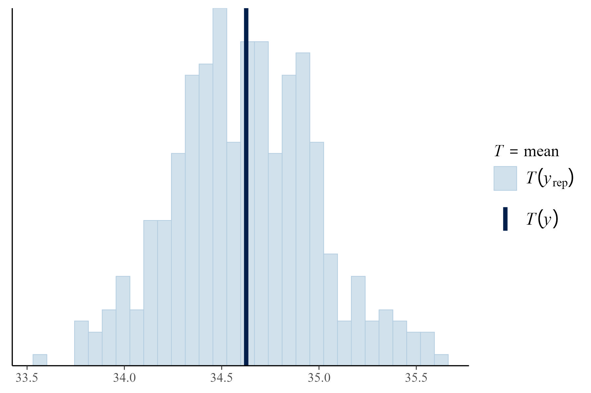
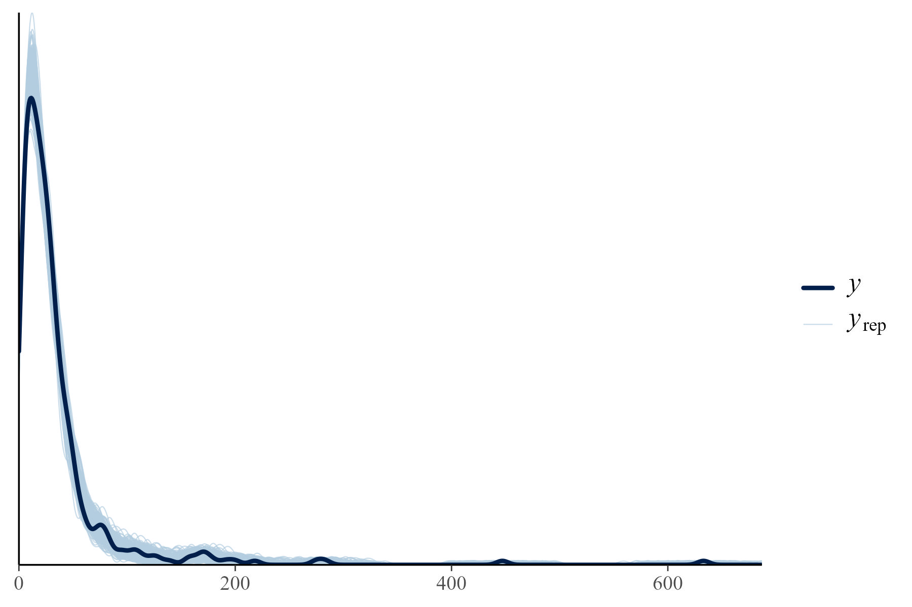
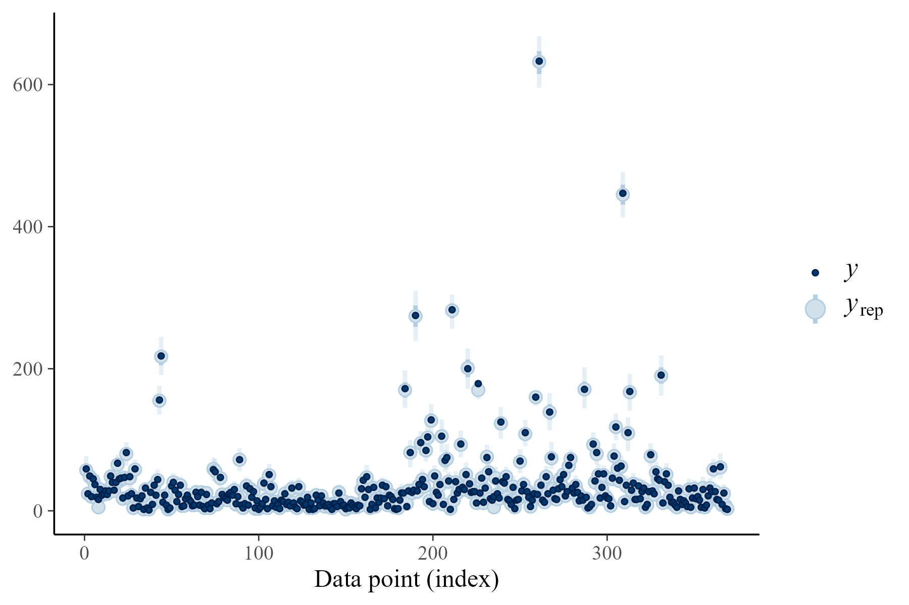

## Summary

We will construct a design stage model using aggregate-level data to predict attrition rates based on trial design features while accounting for differences in trial duration. The model will be similar to that described in NICE Technical Support Document 3 (3.2. Rate data: Binomial likelihood and cloglog link) for modelling rates where event times are not available.

## Data

```{r makedata}
library(tidyverse)

df <- tibble(
  trial_id = c(1, 1, 2, 2),
  r = c(25, 31, 73, 91),
  N = c(100, 101, 203, 204),
  py = c(0.482, 0.482, 0.563, 0.563),
  arm_type = c("Placebo", "Active", "Active", "Placebo"),
  blinding = c("Double", "Double", "Triple", "Triple"),
  phase = c(3L, 3L, 4L, 4L),
  other_covariates = c("...", "...", "...", "...")
)

df %>% knitr::kable()
```

-   r - Attrition event count
-   N - Number of participants in arm
-   py - Mean person-time in years

We settled on a set of covariates with that facilitated model stability. All covariates were dummy coded, with levels within categorical groupings (e.g. blinding) one-hot encoded. 

We will include the following covariates (1 = yes, 0 = no):

-   Sample size (\<250, \>=250-\<500, \>=500-\<750, \>=750-\<1000, \>=1000)
-   Arm size ()
-   Treatment arm type: 1 = placebo, 0 = active comparator
-   Phase 3
-   Blinding (double, triple, quadruple, open-label)
-   WHO regions involved (Europe, Americas, WPac, SEA, African, EMed)
-   Number of arms (2, 3, \>3)
-   Number of sites (\<100)
-   Duration (\<6mths)
-   Single primary outcome

## Model description

### Likelihood

For arm $j$ in trial $i$, we will specify the model likelihood using the binomial distribution:

\begin{aligned}
r_{ij} \sim \text{Binomial}(N_{ij}, \theta_{ij}) \\
\end{aligned}

Where $r$ indicates the observed number of attrition events, $N$ indicates the number of participants and $\theta$ indicates the probability of attrition at person-time $t$.

Informed by findings from our previous IPD analysis of attrition rates, we will model $\theta_{ij}$ as a function of the Gompertz Cumulative Distribution Function (CDF):

\begin{aligned}
F(t_{ij}) &= 1 - \exp \left(-\frac{b_{ij}}{a_{ij}} \exp(a_{ij} t_{ij}) \right),
\end{aligned}

where $a \geq 0$ is the shape parameter and $b \geq 0$ is the rate parameter for trial $i$, with both parameters constrained to be positive.

We initially explored including covariates on both $a$ and $b$, but this specification resulted in convergence issues and model instability. Therefore, we will allow $a$ to vary by arm-trial combination without adjustment, and place covariates on $b$ via a log-linear function with a random intercept:

\begin{aligned}
b_{ij} = \exp(\beta_{0ij} + \beta_{1ij}X_{1ij} + \dots + \beta_{kij}X_{kij} + u_{ij}),
\end{aligned}

where $\beta_{0ij}$ is a random intercept representing the baseline log-hazard for arm $j$ in trial $i$, $X_{1ij} \dots X_{kij}$ are the covariates and $\beta_{1ij} \dots \beta_{kij}$ are the corresponding regression coefficients.

### Shrinkage and regularisation

To reduce the risk of overfitting and improve the interpretability of covariate effects, we will apply shrinkage to the regression coefficients on $b$, parameterising as:

\begin{aligned}
\beta_k = z_k \cdot \tau \cdot \lambda_k
\end{aligned}

where $z_k$ is a latent standard normal variable, $\tau$ is a shrinkage factor applied to all coefficients (i.e. global) and $\lambda_k$ is a covariate-specific (i.e. local) shrinkage factor.

This approach is similar to the Horseshoe prior, allowing most covariates to be shrunk towards zero while permitting a small number of coefficients with strong signals to "escape" shrinkage. This approach assumes that only a subset of covariates will have any meaningful effects, which we believe is reasonable given the moderate number of covariates we will include.

As our primary interest is the effect of trial design features on attrition at the arm-level (placebo and active comparator), we will exclude treatment arm type from shrinkage and assign it a separate weakly informative prior.

### Priors

To promote model stability, we will specify weakly informative priors for $\alpha_{ij}$, $\beta_{0ij}$ and $\beta arm_{ij}$:

\begin{aligned}
\alpha_{ij}, \beta_{0ij}, \beta arm_{ij} &\sim \text{Normal}(0, 1).
\end{aligned}

For shrinkage parameters, we will specify a weakly informative prior for $z_k$ and a half-Student-$t$ for local and global shrinkage:

\begin{aligned}
z_k &\sim \text{Normal}(0, 1),
\end{aligned}
\begin{aligned}
\tau &\sim t^+(3, 0, 1),
\end{aligned}
\begin{aligned}
\lambda_k &\sim t^+(3, 0, 1).
\end{aligned}

The heavily-tailed half-student-$t$ will encourage weaker coefficients to be shrunk towards zero.

## Model code

``` stan
data {
  int<lower=0> I; // Number of trials
  int<lower=0> K; // Number of covariates
  int<lower=0> r[I]; // Observed attrition events per trial
  int<lower=0> N[I]; // Number of participants per trial
  vector[I] dt; // Time in weeks per trial
  vector[I] arm; // Treatment arm (1 = placebo, 0 = active)
  matrix[I, K] X; // Covariates
}

parameters {
  real mu1; // Intercept
  real a_raw; // Raw shape parameter
  real beta_arm;
  
  vector[K] z;
  real<lower=0> tau; // Global shrinkage factor
  vector<lower=0>[K] lambda; // Local shrinkage factor
}

transformed parameters {
  real a = a_raw;
  
  vector[K] beta = z .* tau .* lambda;
  
  vector[I] b = exp(mu1 + arm * beta_arm + X * beta); // Rate
  vector[I] p;

  for (i in 1:I) {
    real exponent = a * dt[i];
    real time_part = (fabs(a) < 1e-6)
      ? dt[i]
      : expm1(exponent) / a;
    
    p[i] = 1 - exp(-b[i] * time_part); // Gompertz CDF
  }
}

model {
  mu1 ~ normal(0, 1);
  a_raw ~ normal(0, 1);
  beta_arm ~ normal(0, 1);
  z ~ normal(0, 1);
  
  lambda ~ student_t(3, 0, 1); // Local scale
  tau ~ student_t(3, 0, 1); // Global scale

  r ~ binomial(N, p);
}

generated quantities {
  vector[I] r_new;
  vector[I] p_new;
  
  real shrinkage_effective_params = sum(lambda ./ sqrt(1 + lambda.^2));

  for (i in 1:I) {
    real exponent = a * dt[i];
    real time_part = (fabs(a) < 1e-6)
      ? dt[i]
      : expm1(exponent) / a;
    p_new[i] = 1 - exp(-b[i] * time_part);
    r_new[i] = binomial_rng(N[i], p_new[i]);
  }

  real rate = exp(mu1); // Baseline hazard
}
```

## Model performance and predictions

The following section demonstrates some results from fitting the model specified in the previous section and plans for predictive applications.

### Diagnostics and posterior predictive checks

```{r traceplot}

```

```{r stat plot}

```

```{r ppc plot}

```

```{r ppc plot2}

```

### Predictions

We can use model estimates to make predictions about attrition rates based on trial design features. The following predictive example was made by passing the summarised mean Gompertz parameters from the fitted model to the Gompertz hazard function.

```{r makedata2}
library(flexsurv)

df2 <- tibble(
  time = c(1, 2, 3, 4, 5, 6, 7, 8, 9, 10, 11, 12, 13, 14, 15, 16, 17, 18),
  a = rep(-0.777, 18),
  b = rep(exp(0.388), 18),
)

df2_haz <- df2 %>% 
  mutate(
    haz = pmap_dbl(
      list(time, a, b),
      ~ hgompertz(x = ..1, shape = ..2, rate = ..3)
    )
  )

plot <- df2_haz %>% 
  ggplot(aes(x = time, y = haz)) +
  geom_line() +
  scale_x_continuous(n.breaks = 17) +
  theme_bw() +
  labs(x = "Trial duration in weeks", y = "Hazard rate")

print(plot)
```

### Prediction with uncertainty

To gauge the uncertainty of predictions, we can sample posterior point estimates using Monte Carlo simulation. To do this, we will sample from a multivariate normal distribution using the coefficients and variance-covariance matrices obtained from the design-stage model posterior draws. We will draw samples using the *mvrnorm* package.

``` r
n <- 100
mu <- matrix(c(rnorm(100, mean = 0.221, sd = 1), rnorm(100, mean = -1.77, sd = 1)), ncol = 2)
colnames(mu) <- c("rate", "shape")
sigma <- matrix(c(0.0289, -0.0004, -0.0004, 0.0561), ncol = 2)
colnames(sigma) <- c("shape", "rate")
rownames(sigma) <- c("shape", "rate")
samples <- mvrnorm(n = n, mu = mu, sigma = sigma)
```
